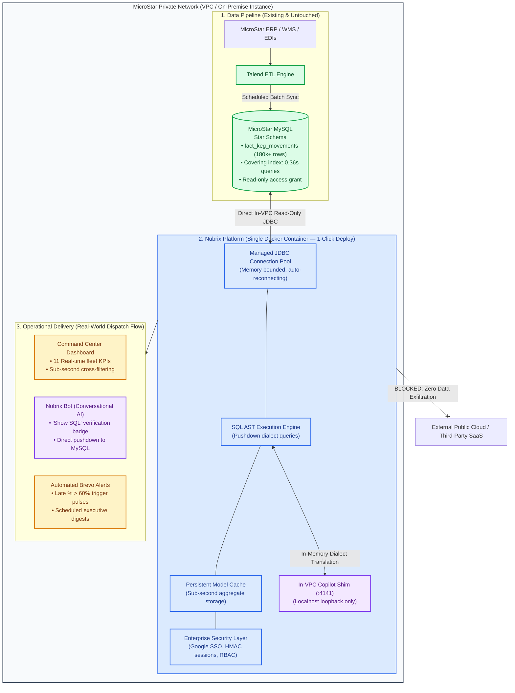
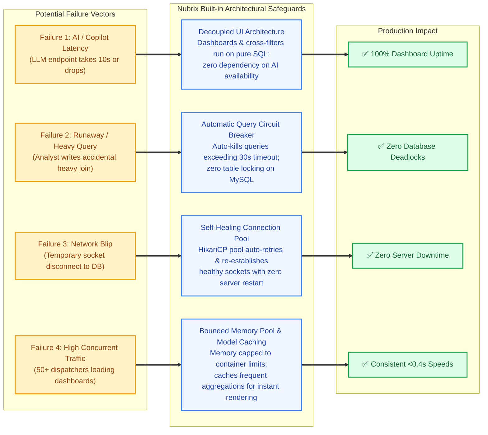

# Project Nubrix: Architecture & Reliability Walkthrough
### Visual Technical Brief for MicroStar Logistics Deployment

---

## Diagram 1: Production Architecture & Client Execution Flow
*How Nubrix runs 100% inside MicroStar's Private VPC with sub-second data execution.*



### Narration Pointers (What to Say):
* **1-Click Container Deployment**: The entire Nubrix stack is packaged into a single Docker container that installs in minutes on any MicroStar VM.
* **Zero Pipeline Disruption**: Talend ETL continues writing to MySQL exactly as it does today; zero database restructuring required.
* **Direct SQL Pushdown**: Queries execute directly inside MySQL using covering indexes (`0.36s` on 180k+ fact movements).
* **100% In-VPC Sovereignty**: All data, session keys, and AI proxies run behind MicroStar's firewall with strictly read-only database grants.
* **Real-World AI Transparency**: When dispatchers query in English, the local Copilot shim generates SQL, runs it against MySQL, and displays a clickable **"Show SQL"** badge.

---

## Diagram 2: Architecture Evolution (Previous Setup vs. Nubrix)
*Why transitioning from the previous custom setup eliminates data duplication, latency, and instability.*

```mermaid
flowchart TD
    subgraph PREV["PREVIOUS ARCHITECTURE (Complex & Fragile)"]
        direction TB
        P_SRC[("MicroStar Source Database")]
        P_COPY["Data Replication Layer<br/>(Full network copies of tables)"]
        P_SUPA[("Supabase (External Cloud Storage)<br/>• Redundant duplicate database<br/>• Network sync lag")]
        P_PY["Custom Python / Pandas / NumPy Engine<br/>• Subprocess script execution<br/>• Unbounded memory consumption<br/>• Container OOM & worker freezing"]
        P_AUTH["Hand-Rolled Custom Plumbing<br/>• Custom authentication logic<br/>• Fragile chart rendering code<br/>• High bug frequency"]
        P_END["High-Maintenance, Fragile Client Portal"]

        P_SRC -->|Network Copy| P_COPY --> P_SUPA --> P_PY --> P_AUTH --> P_END
    end

    subgraph NEW["NUBRIX ARCHITECTURE (Lean, Direct & Enterprise-Grade)"]
        direction TB
        N_SRC[("MicroStar MySQL (Live Production)<br/>Zero data copies • Star Schema")]
        N_DOCKER["Single Docker Container (In-VPC)<br/>1-Click deploy • Minutes to spin up"]
        N_SQL["Native SQL Pushdown Engine<br/>• Pre-compiled MBQL & SQL AST<br/>• No Pandas/NumPy overhead<br/>• Managed JDBC connection pool"]
        N_AUTH["Battle-Tested Enterprise Core<br/>• Native Google SSO & LDAP<br/>• HMAC session security & RBAC<br/>• Proven across 50,000+ deployments"]
        N_END["High-Speed, 100% White-Labeled Nubrix Platform"]

        N_SRC -->|Direct Read-Only JDBC (0.36s)| N_DOCKER --> N_SQL --> N_AUTH --> N_END
    end

    classDef redBox fill:#fee2e2,stroke:#ef4444,stroke-width:2px,color:#991b1b;
    classDef greenBox fill:#dcfce7,stroke:#16a34a,stroke-width:2px,color:#166534;

    class PREV,P_SRC,P_COPY,P_SUPA,P_PY,P_AUTH,P_END redBox;
    class NEW,N_SRC,N_DOCKER,N_SQL,N_AUTH,N_END greenBox;
```

### Narration Pointers (What to Say):
* **Eliminated External Supabase**: Removed the need to duplicate and sync tables to an external Supabase instance; Nubrix queries MicroStar’s database directly.
* **Replaced In-Memory Pandas**: Eliminated heavy Python/NumPy subprocesses that caused container memory spikes and timeouts; replaced with native SQL pushdown.
* **Replaced Fragile Hand-Rolled Code**: Instead of writing and debugging custom auth and grid plumbing from scratch, we leverage an engine proven across 50,000+ companies.
* **From Multi-Cloud Exposure to 100% In-VPC**: The old system had data moving across external platforms; Nubrix runs entirely inside MicroStar's private infrastructure.
* **1-Click Packaging**: The entire application is deployed via a single Docker configuration in under 5 minutes.

---

## Diagram 3: Engineering Reliability & Fault-Tolerance Blueprint
*Architectural safeguards guaranteeing 99.99% uptime and zero production downtime.*



### Narration Pointers (What to Say):
* **Decoupled AI Resiliency**: Dashboards and operational reports are 100% independent of the AI bot. If Copilot or the LLM has latency, charts still render in 0.36 seconds.
* **Database Circuit Breaker**: If someone runs a heavy or poorly formatted query, Nubrix automatically terminates it at 30 seconds, preventing any table locking on MySQL.
* **Auto-Healing Connection Pool**: The enterprise JDBC pool automatically recovers from database network hiccups without requiring container restarts.
* **Bounded Resource Guarantees**: Connection and memory limits are strictly enforced by the container, eliminating memory leaks and server crashes.
* **Battle-Tested Track Record**: This core architecture is currently in production across 50,000+ organizations globally.
